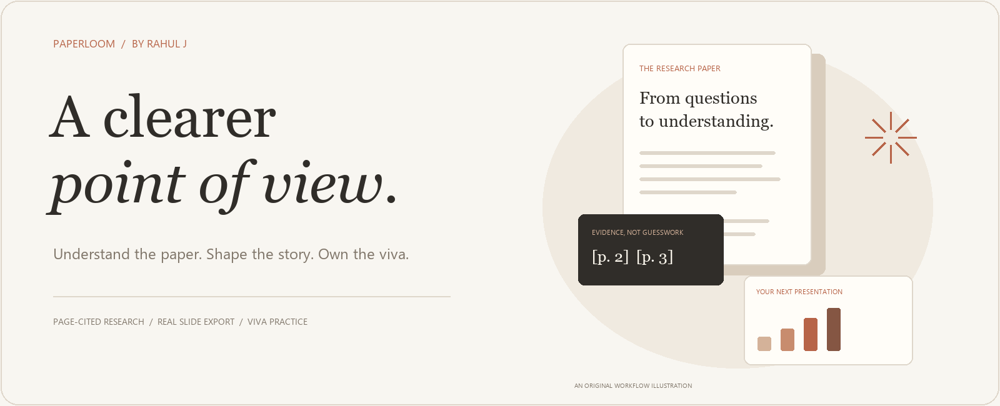
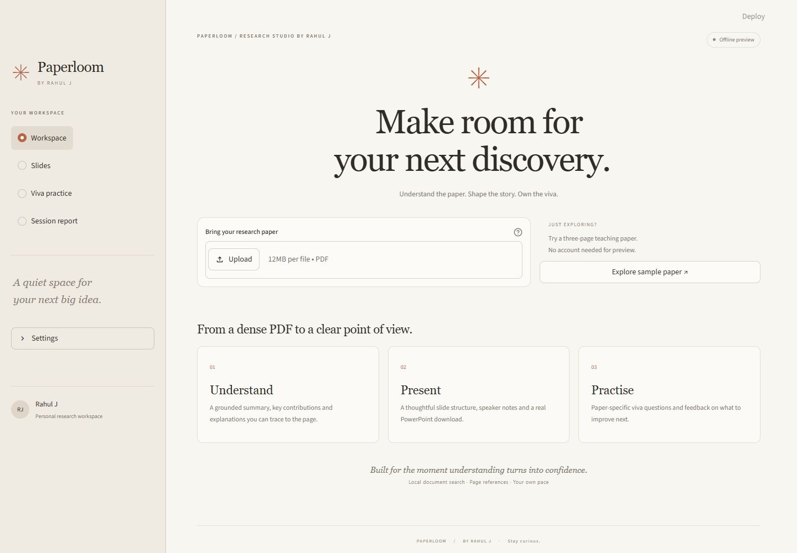
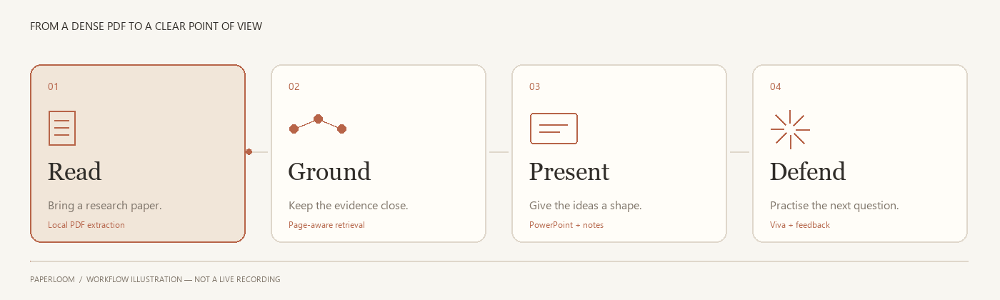
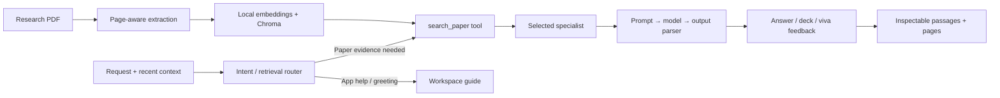

<div align="center">



# Paperloom

### Research Studio by Rahul J

**Understand the paper. Shape the story. Own the viva.**

A calm, source-grounded workspace that turns a research PDF into a conversation, a presentation, and a practice session.

[Get started](#get-started) · [Explore the workflow](#one-paper-four-ways-forward) · [College demo](docs/COLLEGE_DEMO.md) · [Validation](VALIDATION.md) · [MIT licence](LICENSE)

Python 3.11 · Streamlit · LangChain LCEL · Chroma · Groq · PowerPoint

</div>

---

## Less friction between reading and understanding

A research paper rarely arrives presentation-ready. The method needs unpacking. The contribution needs a clear explanation. And a viva demands more than recognising the words on a slide.

Paperloom keeps those steps together. Read with evidence beside you, shape a presentation you can download, then practise explaining the work in your own words.

**Designed for:** students preparing research seminars, paper presentations and viva examinations.



*Actual application screenshot. The cover and workflow graphics are original illustrations, not screenshots or performance evidence.*

## One paper. Four ways forward.

| Workspace | What you do | What you take away |
| :--- | :--- | :--- |
| **Understand** | Ask about the research question, contributions, methods, findings or limitations. | A generated explanation in Live AI mode, with page references and inspectable source passages. |
| **Present** | Choose a focus and 4–10 slides. Review the content before exporting. | A real `.pptx` with speaker notes and source-page footers. |
| **Practise** | Pick a question depth, receive an examiner question and submit your answer. | Paper-grounded feedback and an advisory correctness/depth/clarity rubric in Live AI mode. |
| **Reflect** | Review the conversation, viva attempts and last workflow trace. | A downloadable Markdown session report, with actual activity counts. |

<details>
<summary><strong>Watch the custom animated workflow</strong></summary>



This animation illustrates the architecture. It is **not a recording of live model execution**. Prefer no motion? [Open the static version](docs/assets/paperloom-workflow-static.png).

</details>

## Get started

**You need:** Python 3.11, a modern browser, and internet for installation. No GPU, paid hosting, or cloud vector database is required.

### Windows

Open PowerShell inside the project folder:

```powershell
python -m venv .venv
.\.venv\Scripts\python.exe -m pip install -r requirements-lock.txt
.\.venv\Scripts\python.exe -m streamlit run app.py
```

Open **http://127.0.0.1:8501**. After setup, double-click **`run.cmd`** to start again. You do not need to activate the environment or change PowerShell's execution policy.

### macOS / Linux

```bash
python3 -m venv .venv
.venv/bin/python -m pip install -r requirements-lock.txt
.venv/bin/python -m streamlit run app.py
```

The lock file records the exact dependency versions used in local validation. `requirements.txt` provides the supported version ranges for maintainers. Windows/Python 3.11 has been tested; the GitHub workflow targets Linux/Python 3.11.

### Your first two minutes

1. Select **Explore sample paper ↗**.
2. Choose **Summarize paper**, then open **Evidence & workflow**.
3. Visit **Slides**, prepare a presentation and download the PowerPoint.
4. Visit **Viva practice**, request a question and write an answer.
5. Export your **Session report**.

The sample is an original, three-page teaching document. Its experimental figures are explicitly synthetic. It is not a real published paper or an evaluation benchmark.

## Two modes. Clearly labelled.

| | Offline preview | Live AI |
| :--- | :--- | :--- |
| API key | Not required | Your Groq API key |
| Research answers | Retrieved excerpts, labelled as extractive preview | Specialist-generated explanations grounded in retrieved paper text |
| Slides | Extractive preview deck | Generated slide narrative and notes |
| Viva | Template question and evidence for self-review | Paper-specific questions and rubric-based feedback |
| Scoring | No invented grades | Advisory model judgments, labelled as such |
| Cost | No API calls | Subject to your Groq plan and quota |

**Offline preview is functional, but it is not an LLM demonstration.** It will not pretend to summarise with AI or grade your answer.

### Connect Live AI

Open **Settings**, add your **Groq API key**, choose a model available to your account, and select **Live AI**.

For local configuration instead:

```powershell
Copy-Item .env.example .env
```

Edit `.env` on your own computer:

```dotenv
GROQ_API_KEY=your_key_here
GROQ_MODEL=openai/gpt-oss-20b
```

Restart after editing `.env`. Keys entered in Settings stay in the session and are not written into the repository. Never put credentials in screenshots, reports, issues or commits.

Live mode typically makes one routing request and one specialist request per task. There is no automatic switch to a paid provider. Groq offers a [rate-limited free plan](https://console.groq.com/docs/rate-limits); model access and quotas may change. Public availability is not a promise of unlimited free usage.

## Evidence is part of the interface

Paperloom preserves the original page number when it splits a document. The router decides whether evidence is needed, a retrieval tool searches the selected paper, and a task-specific prompt uses the returned passages.



The four specialists are a **Summarizer**, **Concept Extractor**, **Slide Generator**, and **Viva Examiner/Evaluator**. They are separately prompted task agents selected by a router; they do not autonomously debate in parallel. That keeps the execution path understandable and API usage modest.

Explicit task buttons override an incorrect suggested route. Paper-specific tasks enforce retrieval. Output validation rejects unavailable page numbers and incorrect slide counts. These checks help catch bad output; they do not prove factual correctness or prevent every hallucination.

### Local search, without an embedding bill

- **Semantic indexing:** a local MiniLM ONNX model. The first semantic upload downloads about 80 MB once, then uses the model cache.
- **Offline lexical indexing:** hashed word vectors and cosine search in Chroma. No model download; less capable than semantic retrieval, and labelled accordingly.
- **Teaching sample:** uses lexical indexing for instant onboarding without a model download.

Change the indexing choice before loading a paper. To reindex the same file with a different option, close it and upload it again.

## Built for an academic demonstration

Paperloom addresses **Paper-to-Presentation & Viva Agent**. The implementation makes the required components inspectable:

| Requirement | Where it appears |
| :--- | :--- |
| **LLM integration** | Lazy `ChatGroq` factory in `studio/agents.py`; demonstrate with a valid key. |
| **Interactive GUI** | Uploads, navigation, chat, forms and downloads in `app.py`. |
| **Prompt engineering** | Separate system/user messages, specialist roles, grounding instructions, structured outputs and an evidence-check instruction. |
| **LangChain + LCEL** | Explicit `ChatPromptTemplate \| model \| output_parser` routing and specialist chains. |
| **Agentic RAG** | A live routing decision controls the `search_paper` tool; greetings skip retrieval. |
| **Intent routing** | Summary, concept, slides, viva, evaluation and app-help handlers. |
| **Vector database** | Session-specific embedded Chroma collections and cosine-similarity retrieval. |

The [college demo guide](docs/COLLEGE_DEMO.md) includes a short presentation sequence and the limitations to explain. Faculty acceptance depends on the working demonstration and your understanding of the implementation.

## Small surface. Clear boundaries.

```text
app.py                         Streamlit interface and session state
studio/
  documents.py                 PDF validation, metadata, embeddings and Chroma
  agents.py                    Intent routing, retrieval tool and LCEL specialists
  exports.py                   PowerPoint and Markdown report exporters
ui/studio.css                  Ivory / charcoal / terracotta interface
tests/                         Core and Streamlit interaction tests
scripts/
  check_repository.py          Conservative source/credential hygiene checks
  generate_readme_assets.py    Reproducible original cover and animated diagrams
docs/                          Screenshots, generated visuals and demo guide
.github/workflows/checks.yml    Automated application checks
```

The repository intentionally ships a focused typed-viva application. It does not include legacy webcam servers, voice recordings, another author's source modules, or a bundled dataset of private papers.

## Validation, honestly reported

The standalone release is checked with:

```powershell
.\.venv\Scripts\python.exe -m pytest -q
.\.venv\Scripts\python.exe -m pip check
.\.venv\Scripts\python.exe scripts/check_repository.py
```

**27 automated tests** cover document validation, blank-page numbering, real Chroma retrieval, session isolation, routing, explicit task overrides, LCEL contracts, citation rejection, PowerPoint structure, viva evaluation contracts, missing-key handling, document replacement and the full offline interface journey.

Tests using deterministic model responses check the application's contract. They are not proof of live Groq availability or model quality. See [VALIDATION.md](VALIDATION.md) for exact verification status.

**Known dependency findings:** an audit reports four distinct Chroma server advisories with no listed patched versions. Paperloom uses embedded in-memory Chroma and does not expose that server. This scope assessment is not a clean vulnerability audit. Read [SECURITY.md](SECURITY.md) before changing the deployment model.

## What stays on your computer?

PDF parsing, embeddings, vector search and export happen locally. Uploaded documents are held in memory rather than saved to a shared uploads directory. Closing or replacing a paper clears the conversation, practice answers, deck and document collection.

In **Live AI**, your request, recent conversation and selected paper excerpts are sent to Groq. Use papers you are authorised to send to that provider. Abruptly disconnected sessions can leave collections in process memory until the server stops. This is a local prototype, not a production retention service.

## Limits worth knowing

- Text-based PDFs only; up to **12 MB**, **150 pages**, and **1 million extracted characters**. Scans need OCR first.
- Equations, tables and image-only figures may be extracted poorly or omitted.
- Retrieval uses bounded context and can miss an important passage.
- A valid page number does not establish that a claim is supported by that page.
- Viva scores are advisory model judgments, not measured confidence or academic ability.
- History is temporary. Download the session report before restarting.
- Native PowerPoint visual rendering is not part of the automated suite; long generated slides may need editorial shortening.

<details>
<summary><strong>Troubleshooting</strong></summary>

| Symptom | What to try |
| :--- | :--- |
| Indexing is slow the first time | Let MiniLM download, or select Offline lexical before uploading. |
| No usable text | OCR the PDF externally and upload the text-based result. |
| Key or model rejected | Check your Groq console, key and currently available models. |
| Rate limit | Wait for quota recovery or use offline preview. |
| Missing/invalid citation or wrong slide count | Retry. The application rejects the response rather than exporting it silently. |
| Port 8501 is already in use | Use the existing instance or launch with `--server.port 8502`. |

</details>

## Licence & credits

**MIT © 2026 Rahul J.** See [LICENSE](LICENSE).

Paperloom is a clean standalone release of the newly written workspace developed after reviewing [ViVaMaTe AI](https://github.com/preetmish086/ViVaMaTe-AI) as a reference. No upstream source, assets, recordings or Git history are included or relicensed here. Dependencies and the downloaded embedding model retain their own licences. Full provenance: [NOTICE.md](NOTICE.md).

The cover and animated diagrams were generated specifically for this project from the versioned drawing script. To reproduce them, install Pillow and run `python scripts/generate_readme_assets.py`.

---

<div align="center">

**Paperloom · by Rahul J**<br>
*Stay curious. Keep the evidence close.*

</div>
